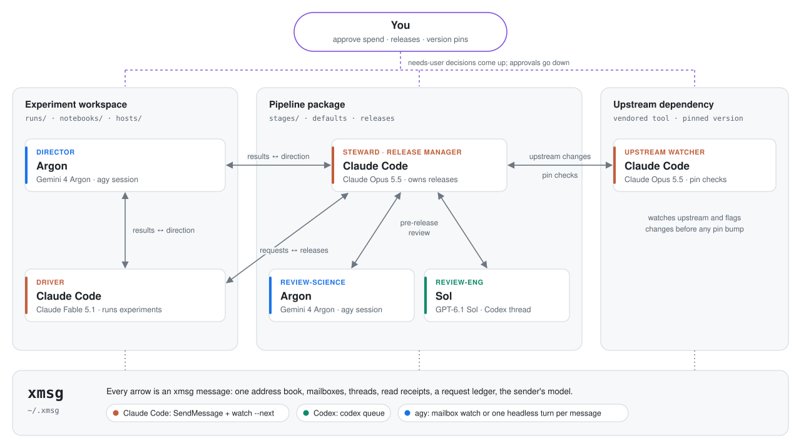

# xmsg

Messages, roles and a request ledger across coding-agent CLIs from different labs: Claude Code, Codex,
Antigravity (`agy`), Grok and Muse sessions running on one machine.

Each vendor lets its own agents message each other: Claude Code has `SendMessage`, Codex has
`codex queue`, Muse has `session-message`. None of them reaches the others. Shelling out to `codex exec`
or `agy --print` starts a fresh agent that forgets everything after one answer. xmsg lets long-running
sessions from different labs work as one team. A director gives direction, executors own the work, and
reviewers check it. You stay the one who approves anything that costs money or can't be undone.

```bash
# In any Claude Code or Codex session, or your own terminal:
xmsg request --to director --wait --link runs/ablation-3/RESULT.md \
  --body "Ablation arms B and C both missed the bar by about 0.05. Which arm should we run next, and what result would falsify it?"
```

The request goes to whichever session holds the `director` role, for example an Argon conversation in
`agy`. The director reads the linked files itself, and its answer comes back as the command's output.
Both are recorded in a ledger every session can read.

## What it does

- **One address book.** It lists live Claude Code sessions automatically, plus registered Codex
  threads, agy, Grok and Codex-exec conversations, and Muse sessions. Names are matched loosely
  ("Build 7" = `build-7`).
- **Each family's own transport.** It never touches another agent's transcript or internal socket.

  | Recipient | Delivery |
  |---|---|
  | Claude Code | durable mailbox, announced by the session's `xmsg watch --next` (a background command that ends when mail arrives) |
  | Codex (live thread) | `codex queue --thread ID`, injected into the thread's next turn; `--wake` also resumes it |
  | agy, Grok, Codex (idle conversation) | one headless turn on the saved conversation per message; the output comes back as the reply |
  | Muse | `muse session-message send` |

- **Roles and ownership.**
  - `--to director` reaches whoever fills the role today; `xmsg role director <peer>` swaps it.
  - A role can name several peers, and a send fans out to all of them (`xmsg role review sol astra`).
  - `--to owner:atlas` routes by declared ownership.
- **A request ledger.**
  - Requests move through open → accepted → running → blocked → done / rejected / superseded.
  - The recipient owns a request's status; the requester adds notes.
  - Read receipts separate queued, delivered, read and answered.
  - Every message keeps its thread.
- **Attribution.** Every message records its sender's model. For Claude Code and Codex senders it is
  detected from the session's own transcript, so a mid-session model switch is recorded correctly.
- **Low token cost.** `--wait` returns a headless peer's answer as the output of one command, with no
  watcher needed. `watch --next` waits without spending tokens. `xmsg log -f --bodies` lets you read
  every message yourself, so agents don't need to repeat replies to you.

## Install

Requirements: Python 3.10+ on macOS or Linux (it uses `fcntl` and `ps`), and the agent CLIs you want
to connect. It has no dependencies.

```bash
uv tool install git+https://github.com/rk23/xmsg     # or: pipx install git+https://github.com/rk23/xmsg
xmsg install-skill                                    # copies the agent skill to ~/.claude/skills and ~/.agents/skills
```

The skill (`skills/xmsg/SKILL.md`) teaches Claude Code and Codex agents when and how to use xmsg:
- asking the director with `--wait`;
- watching for mail with `watch --next`;
- not repeating replies to you;
- checking a reviewer's claims against the files before acting on them;
- leaving approval to you.

## Quick start

```bash
# A director: seed an Argon conversation interactively, exit, then register it.
cd ~/project && agy --model gemini-4-argon-high          # give it the current state, then exit
xmsg register argon --family agy --cwd ~/project --model gemini-4-argon-high
xmsg role director argon

# A reviewer in a live Codex thread (its thread id, or run `xmsg register --self` inside it).
xmsg register sol --family codex --address THREAD_UUID --owns efficiency
xmsg role review-eng sol

# A Claude Code session that owns some work (run inside it).
xmsg register --self --owns experiments

xmsg peers                 # who is registered, their roles, watchers and unread mail
xmsg log -f --bodies       # a live feed of every message, in a spare terminal
xmsg ledger --open         # open requests and their states
```

## Example: a research team across three repos

<picture>
  <source media="(prefers-color-scheme: dark)" srcset="docs/images/team-dark.svg">
  
</picture>

xmsg grew out of this setup: a long-running research project with three repos. The experiment workspace
holds runs, notebooks and compute hosts. The pipeline package holds the code those experiments run. The
third is a vendored upstream tool. Six sessions from three labs each work in the repo they are
responsible for:

| Session | Role | Model | Works in | Owns |
|---|---|---|---|---|
| Argon (agy) | `director` | Gemini 4 Argon | experiment workspace | science, math, direction |
| Claude Code | `driver` | Claude Fable 5.1 | experiment workspace | experiments, hosts, controls |
| Claude Code | `steward` (release manager) | Claude Opus 5.5 | pipeline package | package, releases, defaults |
| Argon (agy) | `review-science` | Gemini 4 Argon | pipeline package | package-review-science |
| Sol (Codex) | `review-eng` | GPT-6.1 Sol | pipeline package | package-review-eng, efficiency |
| Claude Code | upstream watcher | Claude Opus 5.5 | upstream dependency | upstream, pin |

```bash
# Experiment workspace: the director and the driver.
cd ~/work/experiments && agy --model gemini-4-argon-high    # seed it with the project state
xmsg register argon --family agy --delivery mailbox --cwd ~/work/experiments \
  --model gemini-4-argon-high --owns science,math,direction
xmsg role director argon
xmsg register --self --owns experiments,hosts,controls      # inside the driving Claude Code session
xmsg role driver "<that session's name>"

# Pipeline package: the steward and its two reviewers.
xmsg register --self --owns package,releases,defaults       # inside the package's Claude Code session
xmsg role steward "<that session's name>"
xmsg register argon-pkg --family agy --delivery mailbox --cwd ~/work/pipeline \
  --model gemini-4-argon-high --owns package-review-science
xmsg register sol --family codex --address THREAD_UUID --owns package-review-eng,efficiency
xmsg role review-science argon-pkg
xmsg role review-eng sol

# Upstream dependency: a watcher in the vendored checkout.
xmsg register --self --owns upstream,pin                    # inside that Claude Code session
```

Both Argon sessions are interactive agy sessions that keep `xmsg watch --next` running. If you leave out
`--delivery mailbox`, xmsg instead runs one headless turn on the conversation for each message.

A typical loop:

1. **The driver asks the director.** After a run, it sends
   `xmsg request --to director --wait --link runs/.../RESULT.md --file brief.md`. The director reads the
   files and answers with a direction and the result that would falsify it. The driver checks the
   director's claims about the code and data before acting on them.
2. **The driver asks the steward.** When an experiment needs a pipeline change, the driver sends a
   request with a reproducer to `owner:package`. The two Claude sessions also talk directly with
   `SendMessage`.
3. **The steward asks both reviewers before releasing:** `xmsg request --to review-science,review-eng --link <diff>`.
4. **The reviewers reply with findings.** Each reviewer owns its request's status
   (accepted → running → done). The steward verifies each finding, fixes what holds up, and records the
   rest with `xmsg note`.
5. **The steward releases.** It sends the driver a receipt: the version, what changed, and whether
   outputs are bit-identical to the previous release.
6. **The upstream watcher reports changes.** It tells the steward about upstream changes that touch the
   pipeline before any pin bump.
7. **You decide anything that costs money, publishes or moves a pin.** Those messages are flagged
   `--needs-user`. You can follow everything with `xmsg log -f --bodies`.

## Commands

```text
send / request   --to NAME|ROLE|owner:TOPIC[,...] [--wait] [--re ID] [--link PATH] [--needs-user] [--model M]
reply ID         [--state STATE] [--link PATH]
inbox, read ID, show ID, status ID
watch            [--next] [--max-wait S]     announce new mail (--next: exit on arrival, run in the background)
state ID STATE   (recipient)    note ID TEXT (anyone)
ledger           [--open] [--who NAME] [--json]
log              [-f] [--bodies]
register, unregister, role, peers, whoami
stop [--clear]   hold all headless turns
install-skill    [--dest DIR]
```

State lives in `~/.xmsg` (override with `XMSG_HOME`):
- `peers.json`;
- one immutable JSON file per message;
- an append-only `events.jsonl`;
- inbox markers, watcher heartbeats and logs of headless turns.

## Safety model

- **Messages are advisory.** No peer message carries the user's approval. The skill tells agents that
  spend, launches, pins, pushes and publication still need a yes in their own session.
- **No injection.** xmsg uses only each CLI's public commands and its own files. It never writes to
  another agent's transcript, session database or internal socket.
- **Headless turns run with the CLI's normal permissions.** xmsg adds no sandbox of its own; the brief
  tells the agent what is wanted. Turns run one at a time per peer, are capped per day
  (`--max-turns-per-day`, default 24), and stop while `~/.xmsg/STOP` exists (`xmsg stop`).
- **Model detection reads only the sender's own transcript.** It reads the end of that session's
  transcript file and keeps only the model name.
- **Local only.** There is no network service. Anything that can run commands as your user can read
  and write `~/.xmsg`.

## Status

This is version 0.1.0. It was tested on macOS with:
- Claude Code 2.1.319;
- codex-cli 0.167.0, through `codex queue` and `codex exec resume`;
- agy 1.5.3, through headless turns on a saved conversation.

The Grok and Codex-exec turn presets are starting points; verify one manual turn first. Muse delivery
needs Muse's external-agent ingress to be enabled. Behaviour of the vendor CLIs can change between
versions.

## Related work

- [MCP Agent Mail](https://github.com/Dicklesworthstone/mcp_agent_mail): a mail-like coordination
  server for coding agents (identities, inboxes, threads, file leases). Agents check it for mail.
  xmsg instead wakes each session through its own CLI, and adds roles and model attribution.
- [A2A (Agent2Agent)](https://a2a-protocol.org/): the networked standard for agent cards and task
  lifecycles. xmsg's request states map closely to A2A's task states.
- [PAL MCP `clink`](https://github.com/BeehiveInnovations/pal-mcp-server): lets one CLI launch another
  as a short-lived subagent.
- [Gas Town](https://github.com/gastownhall/gastown) and Beads: orchestration of many coding agents
  with named roles and a Git-backed issue tracker.
- The FIPA Request interaction protocol (request → agree or refuse → done or failure), actor-model
  mailboxes and blackboard systems are the older roots of the same ideas.

## License

MIT
