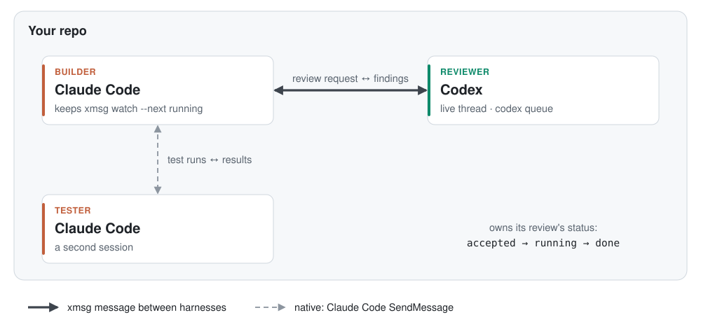

# Example: a builder and a reviewer from different labs

A Claude Code session builds and a live Codex thread reviews, side by side in one repo. A second Claude
Code session runs tests, so this setup shows both kinds of link.

<picture>
  <source media="(prefers-color-scheme: dark)" srcset="diagram-dark.svg">
  
</picture>

The thick arrow is an xmsg message between harnesses, delivered with `codex queue` one way and the
builder's mailbox the other. The dashed arrow is Claude Code's own `SendMessage` between its two sessions.

## Set it up

```bash
# In the Codex thread (xmsg reads its thread id from CODEX_THREAD_ID):
xmsg register reviewer --self --owns review

# In the builder's Claude Code session:
xmsg register builder --self --owns build
# Then keep `xmsg watch --next` running with Bash run_in_background: true. It ends when mail
# arrives; read the message, then start it again.
```

If Codex's sandbox blocks writes to `~/.xmsg`, add that path to `sandbox_workspace_write.writable_roots`
in your Codex config.

## The loop

1. **The builder asks for a review.**
   `xmsg request --to reviewer --wake --link changes.diff --body "Review the cache rewrite; focus on eviction under load."`
   `--wake` resumes the Codex thread if it is idle.
2. **The reviewer reports progress.** It owns the request's status: `xmsg state ID accepted`, then
   `running`. Then it replies: `xmsg reply ID --state done --link review.md --body "3 findings; #1 is a real race."`
3. **The builder sees the reply.** Its watcher ends with the reply's id. It checks each finding against
   the code, fixes what holds up, and records the outcome: `xmsg note ID "fixed #1 and #3; #2 not reproducible"`.
4. **The builder and the tester talk directly** with `SendMessage`. Either can still use
   `xmsg request --to tester` when it wants that exchange in the ledger.
