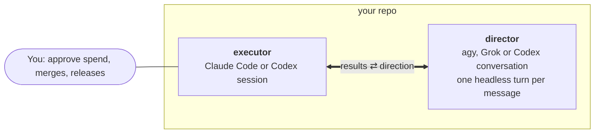

# Example: a director and an executor

One model sets direction; a coding agent does the work and comes back with results. This is the smallest
useful xmsg setup. The two sessions can run any models their CLIs support.



The thick arrow is an xmsg message between two different harnesses. The plain line from you is a decision,
not a message.

## Set it up

```bash
# 1. Seed the director once, from the repo it should read. Give it the goals and the
#    current state, then exit.
cd ~/repo && agy                          # or grok, or codex

# 2. Register it and give it the role. For agy, xmsg finds the conversation you just had here.
xmsg register planner --family agy --cwd ~/repo
#   Grok:          xmsg register planner --family grok --address SESSION_ID --cwd ~/repo
#   An idle Codex: xmsg register planner --family codex-exec --address THREAD_UUID --cwd ~/repo
xmsg role director planner

# 3. In the executor session (Claude Code or Codex):
xmsg register --self --owns implementation
```

## The loop

1. **The executor finishes a step and asks for direction.** In Claude Code, it runs this with Bash
   `run_in_background: true`:
   ```bash
   xmsg request --to director --wait --link results/step-3.md \
     --body "Step 3 cut latency 18% but doubled memory. Keep going, or try the streaming design?"
   ```
2. **The director answers.** xmsg runs one headless turn on its conversation. The director can read the
   linked files, and its answer comes back as the command's output.
3. **The executor checks before acting.** It verifies the director's claims about the code and records
   what it decided: `xmsg note ID "taking the streaming design; spike in branch stream-1"`.
4. **Swapping the director is one command:** `xmsg role director <another peer>`. The executor keeps
   writing `--to director`.

## Notes

- **Each director turn costs one model call.** `register --max-turns-per-day N` caps them (default 24),
  and `xmsg stop` holds every turn until `xmsg stop --clear`.
- **Don't drive the director's conversation from two places at once.** Keep it closed in its own CLI
  while xmsg is running turns on it.
- **Check a preset first.** Grok and `codex-exec` presets are starting points: run one manual turn with
  the exact command before relying on it (`register --turn-cmd` sets your own).
