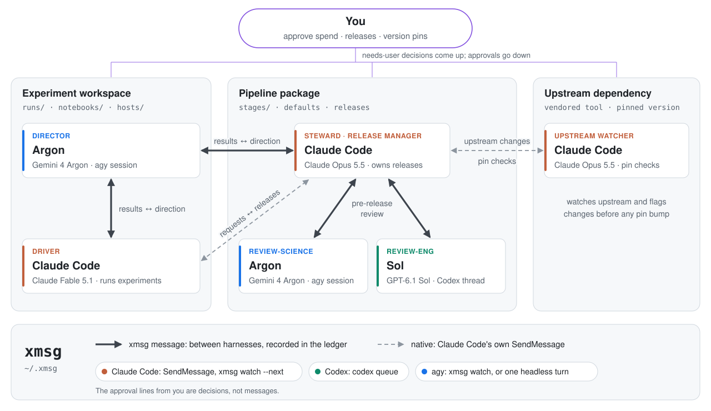

# Example: a research team across three repos

<picture>
  <source media="(prefers-color-scheme: dark)" srcset="team-dark.svg">
  
</picture>

**Line styles.** A thick arrow is an xmsg message between two different harnesses, for example a Claude Code
session and an agy session. Every such message is recorded in the ledger. A dashed arrow is a harness's
own messaging between two of its sessions: here the Claude Code sessions use `SendMessage` with each other.
Those sessions can still use `xmsg request` when they want a ledger entry.

xmsg grew out of this setup: a long-running research project with three repos. The experiment workspace
holds runs, notebooks and compute hosts. The pipeline package holds the code those experiments run. The
third is a vendored upstream tool. Six sessions from three labs each work in the repo they are
responsible for:

| Session | Role | Model | Works in | Owns |
|---|---|---|---|---|
| Argon (agy) | `director` | Gemini 4 Argon | experiment workspace | science, math, direction |
| Claude Code | `driver` | Claude Fable 5.1 | experiment workspace | experiments, hosts, controls |
| Claude Code | `steward` (release manager) | Claude Opus 5.5 | pipeline package | package, releases, defaults |
| Argon (agy) | `review-science` | Gemini 4 Argon | pipeline package | package-review-science |
| Sol (Codex) | `review-eng` | GPT-6.1 Sol | pipeline package | package-review-eng, efficiency |
| Claude Code | upstream watcher | Claude Opus 5.5 | upstream dependency | upstream, pin |

```bash
# Experiment workspace: the director and the driver.
cd ~/work/experiments && agy --model gemini-4-argon-high    # seed it with the project state
xmsg register argon --family agy --delivery mailbox --cwd ~/work/experiments \
  --model gemini-4-argon-high --owns science,math,direction
xmsg role director argon
xmsg register --self --owns experiments,hosts,controls      # inside the driving Claude Code session
xmsg role driver "<that session's name>"

# Pipeline package: the steward and its two reviewers.
xmsg register --self --owns package,releases,defaults       # inside the package's Claude Code session
xmsg role steward "<that session's name>"
xmsg register argon-pkg --family agy --delivery mailbox --cwd ~/work/pipeline \
  --model gemini-4-argon-high --owns package-review-science
xmsg register sol --family codex --address THREAD_UUID --owns package-review-eng,efficiency
xmsg role review-science argon-pkg
xmsg role review-eng sol

# Upstream dependency: a watcher in the vendored checkout.
xmsg register --self --owns upstream,pin                    # inside that Claude Code session
```

Both Argon sessions are interactive agy sessions that keep `xmsg watch --next` running. If you leave out
`--delivery mailbox`, xmsg instead runs one headless turn on the conversation for each message.

A typical loop:

1. **The driver asks the director.** After a run, it sends
   `xmsg request --to director --wait --link runs/.../RESULT.md --file brief.md`. The director reads the
   files and answers with a direction and the result that would falsify it. The driver checks the
   director's claims about the code and data before acting on them.
2. **The driver asks the steward.** When an experiment needs a pipeline change, the driver sends a
   request with a reproducer to `owner:package`. The two Claude sessions also talk directly with
   `SendMessage`.
3. **The steward asks both reviewers before releasing:** `xmsg request --to review-science,review-eng --link <diff>`.
4. **The reviewers reply with findings.** Each reviewer owns its request's status
   (accepted → running → done). The steward verifies each finding, fixes what holds up, and records the
   rest with `xmsg note`.
5. **The steward releases.** It sends the driver a receipt: the version, what changed, and whether
   outputs are bit-identical to the previous release.
6. **The upstream watcher reports changes.** It tells the steward about upstream changes that touch the
   pipeline before any pin bump.
7. **You decide anything that costs money, publishes or moves a pin.** Those messages are flagged
   `--needs-user`. You can follow everything with `xmsg log -f --bodies`.

To regenerate the diagram after editing it, run `python3 make_diagram.py` in this directory. That writes
`team-light.svg` and `team-dark.svg`.
