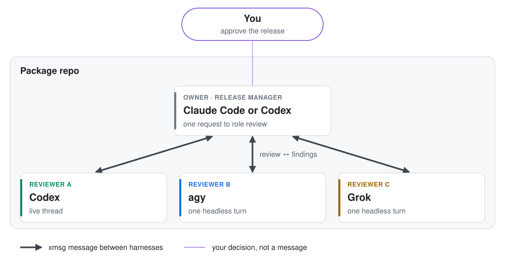

# Example: a review board before each release

A package owner asks reviewers from several labs to look at every release. Each reviewer runs on a
different harness, so their blind spots differ. One `request` reaches them all, and the ledger shows
where each review stands.

<picture>
  <source media="(prefers-color-scheme: dark)" srcset="diagram-dark.svg">
  
</picture>

Every thick arrow is an xmsg message, and each reviewer is reached through its own harness:
- `codex queue` for the Codex thread;
- one headless turn for the agy and Grok conversations.

## Set it up

```bash
xmsg register reviewer-a --family codex --address THREAD_UUID --owns review-engineering
xmsg register reviewer-b --family agy --cwd ~/pkg --owns review-math    # agy's latest conversation in ~/pkg
xmsg register reviewer-c --family grok --address SESSION_ID --cwd ~/pkg --owns review-alternatives
xmsg role review reviewer-a reviewer-b reviewer-c

# In the owner's session:
xmsg register owner --self --owns package,releases
```

## The loop

1. **The owner asks every reviewer at once.** One command creates a separate, tracked request for each:
   ```bash
   xmsg request --to review --link release-1.4.diff --link CHANGELOG.md \
     --body "Review 1.4 before release: correctness of the new merge rule, and any speed regressions."
   ```
2. **The owner waits for the board.** `xmsg ledger --open --who owner` shows each request's status.
   Add `--wait` to the request to block until every reviewer has answered.
3. **Each reviewer owns its request's status** and closes it with its findings:
   `xmsg reply ID --state done --body "..."`.
4. **The owner works through the findings.** It verifies each against the code and fixes what holds up.
   It records the rest, for example `xmsg note ID "finding 2 rejected: the benchmark used a cold cache"`.
5. **The owner releases only after you say yes,** in its own session. A reviewer's "done" is not a
   release approval.

A role can name any mix of harnesses, so adding a fourth reviewer is one `register` plus one `role` command.
